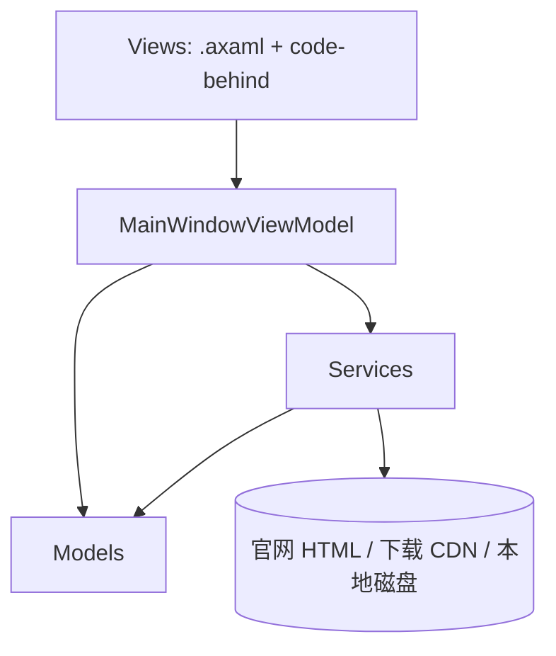

# 架构

## 技术栈

| 层次 | 选型 |
| --- | --- |
| 运行时 | .NET 10（`net10.0`），C#，`Nullable=enable` |
| UI | Avalonia 12.1.6，Fluent 主题 + Inter 字体，XAML 编译绑定 |
| MVVM | `CommunityToolkit.Mvvm` 8.4.2（`ObservableObject`、`[ObservableProperty]`、`[RelayCommand]` 源生成） |
| 网络 | `HttpClient`（官网归档页 HTML、官方下载直链） |
| 持久化 | `System.Text.Json` → `state.json` |
| 压缩包 | `System.IO.Compression.ZipFile` |
| 调试 | `AvaloniaUI.DiagnosticsSupport` 2.2.3（仅 Debug，`F12` 开发者工具） |

## 分层



- **View**：`MainWindow.axaml`、`SettingsWindow.axaml`、`ConfirmWindow.axaml` 及其 code-behind。只负责布局、绑定和平台交互；设置窗口与主窗口共用同一个 ViewModel 实例。
- **ViewModel**：唯一一个 `MainWindowViewModel`，持有全部界面状态与命令，不直接引用 Avalonia 平台类型。
- **Services**：无 UI 依赖的纯逻辑（解析、下载、解压扫描、清理、配置读写）。
- **Models**：纯数据对象，其中 `AppState` 同时是持久化契约。

窗口相关的能力通过**委托注入**进入 ViewModel：`MainWindow.axaml.cs` 构造 VM 时传入 `Func<Task<string?>>`（文件夹选择）和 `Func<string, string, Task<bool>>`（确认框），因此 VM 不需要持有 `Window` / `IStorageProvider`。

## 目录结构

```text
GodotManager/
├─ Program.cs                 入口、AppBuilder 配置
├─ App.axaml(.cs)             应用资源（FluentTheme、Godot 蓝主配色、全局样式）、生命周期
├─ MainWindow.axaml(.cs)      主界面、平台交互、双击启动、设置按钮
├─ SettingsWindow.axaml(.cs)  设置弹窗（语言 / 安装目录 / 安装包策略）
├─ AboutWindow.axaml(.cs)     关于窗口（版本 / 作者 / 仓库地址）
├─ ConfirmWindow.axaml(.cs)   卸载确认对话框
├─ GodotManager.csproj        目标框架与 NuGet 依赖
├─ app.manifest               Windows 应用清单
├─ Models/
│  ├─ GodotRelease.cs         在线发布版本
│  ├─ InstalledVersion.cs     已安装版本记录
│  ├─ MajorGroup.cs           竖向 tab（全部 / 4.x / 3.x ...）
│  ├─ ReleaseCache.cs         版本列表缓存 DTO
│  └─ AppState.cs             持久化配置结构
├─ Services/
│  ├─ GodotArchiveService.cs  归档页抓取解析 + GodotVersionComparer
│  ├─ DownloadService.cs      下载直链构造 + 流式下载进度
│  ├─ InstallService.cs       解压、扫描、安装包清理
│  ├─ ReleaseCacheService.cs  releases-cache.json 读写与容错
│  ├─ LocalizationService.cs  中英文本字典、属性通知、模板格式化
│  ├─ ShellService.cs         跨平台打开链接 / 目录（资源管理器 / Finder / xdg-open）
│  ├─ AppInfo.cs              作者、仓库地址、版本号
│  └─ AppStateService.cs      state.json 读写与容错
└─ ViewModels/
   └─ MainWindowViewModel.cs  全部界面状态与命令
```

注意：`GodotVersionComparer`（语义化版本比较、主版本提取）定义在 `Services/GodotArchiveService.cs` 文件内，与 `GodotArchiveService` 同属 `GodotManager.Services` 命名空间，没有独立文件。

## 模块职责

| 模块 | 职责 |
| --- | --- |
| `GodotArchiveService` | `FetchAsync()` 抓取归档页，`Parse()` 用正则提取版本号 / 类型 / 日期 / 下载页；去重后按版本号降序、日期降序排序 |
| `GodotVersionComparer` | 逐段数值比较版本（`4.10 > 4.9 > 4.7.2 > 4.7`），`GetMajor()` 供竖向 tab 分组 |
| `DownloadService` | `BuildDownloadUrl()` 拼 `downloads.godotengine.org` 直链；`DownloadAsync()` 流式写文件、节流上报进度、支持取消 |
| `InstallService` | `GetTempZipPath()` 定位 `<安装目录>\downloads`；`Install()` 解压并定位主 exe；`Scan()` 扫描已有版本；`CleanupExpiredDownloads()` 清理过期安装包 |
| `AppStateService` | 读写 `%LOCALAPPDATA%\GodotManager\state.json`，配置损坏或目录不可用时回退默认值 |
| `ReleaseCacheService` | 读写 `releases-cache.json`，在 `GodotRelease` 与缓存 DTO 之间转换；读损坏或写失败都静默降级 |
| `LocalizationService` | 单例，持有 `Zh` / `En` 文本字典；`SetLanguage()` 通知所有字符串属性刷新，`F(key, args)` 格式化带参数文案 |
| `ShellService` | 跨平台打开链接与目录：Windows `UseShellExecute` / `explorer.exe`、macOS `open`、Linux `xdg-open`；`CreateOpenCommand()` 可单独验证各平台命令 |
| `MainWindowViewModel` | 加载 / 缓存 / 刷新节流 / 筛选 / 排序 / tab / 下载 / 安装 / 启动 / 卸载 / 换目录 / 设置项的全部状态机 |
| `SettingsWindow` | 复用主 VM 作为 DataContext，配置语言 / 安装位置 / 安装包策略，改动即时生效；底部可打开关于窗口 |
| `AppInfo` / `AboutWindow` | 集中保存作者、仓库地址与版本号；关于窗口复用主 VM 的本地化，仓库链接走 `ShellService` |
| `MainWindow.axaml.cs` | `StorageProvider` 文件夹选择、`ConfirmWindow` 对话框、双击启动、打开设置窗口 |

ViewModel 命令（`[RelayCommand]` 生成）：`LoadReleasesCommand`（启动，缓存优先）、`RefreshReleasesCommand`（刷新图标，联网 + 30 秒节流）、`DownloadCommand`（接收列表项 `GodotRelease`，下载指定版本）、`CancelDownloadCommand`、`OpenNewsCommand`（打开该版本在归档页的 News 公告，缺少公告时回退到版本详情页）、`LaunchCommand`、`OpenFolderCommand`、`UninstallCommand`、`BrowseInstallDirectoryCommand`。

## 数据流

1. **启动**：`Program.Main` → `App` → `MainWindow` 构造 VM → VM 构造时读取 `state.json`、清理过期安装包、扫描安装目录并写入记录 → `LoadReleasesAsync()` 先读 `releases-cache.json`，缓存有效（默认 2 天内）则直接加载，否则联网拉取。
2. **在线列表 / 刷新**：联网时 `FetchAsync()` 拿 HTML → `Parse()` 得到 `GodotRelease` 列表 → **成功后写入缓存** → `SetReleases()` 重建 tab 并筛选 → `FilteredReleases` 绑定 ListBox。点刷新图标会强制联网；若距上次「刷新触发的联网」不足 30 秒，则不发请求，直接从本地缓存重新解析。联网失败时回退到本地缓存（忽略过期），保证列表可用。
3. **下载安装**：`BuildDownloadUrl()` → `DownloadAsync()` 写入 `<安装目录>\downloads\*.zip` → `Install()` 以包内主 exe 名（如 `Godot_v4.4.1-stable_mono_win64`）作为版本目录名，剥掉官方包自带的同名外层目录后解压并定位主 exe → 追加 `InstalledVersion` 记录并保存 → 按设置窗口里的安装包策略决定是否删除 zip（默认保留 30 天；取消或失败始终删除残缺文件）。
4. **扫描已有版本**：遍历安装目录的一级子目录（跳过 `downloads`），找匹配 `Godot_v{版本}-{类型}[_mono]_win(32|64).exe` 的主程序（忽略 `_console.exe`）；根目录直接放的 exe 也识别。按 exe 路径去重，UI 只显示位于当前安装目录下的记录。
5. **启动 / 卸载**：`Process.Start` 直接启动记录的 exe；卸载删除版本目录（若 exe 就在安装目录根下，则只删该 exe，避免删掉整个安装目录）。
6. **临时文件清理**：启动时以及切换安装目录时，删除 `downloads` 内修改时间超过 `TempFileRetentionDays`（默认 30 天）的 `.zip` / `.part`；安装目录根目录下的旧 zip 不动。

## 状态与持久化

配置文件：`%LOCALAPPDATA%\GodotManager\state.json`（首次运行自动创建）。

| 字段 | 类型 | 说明 |
| --- | --- | --- |
| `InstallDirectory` | string | 安装目录，默认 `%LOCALAPPDATA%\GodotManager\versions` |
| `Language` | string | 界面语言 `zh` / `en`，默认 `zh`；切换立即生效 |
| `UseMono` | bool | 主界面「.NET 版」勾选状态，默认 `true` |
| `SelectedMajor` | int? | 主版本 tab 选中项（`null` = 全部），随启动恢复 |
| `DeleteArchiveAfterInstall` | bool | 安装包策略：`false` = 保留 30 天（默认），`true` = 安装完成后立即删除 |
| `TempFileRetentionDays` | int | 安装包保留天数，默认 `30` |
| `CacheExpirationDays` | int | 版本列表缓存有效期（天），默认 `2` |
| `RefreshCooldownSeconds` | int | 两次刷新联网的最小间隔（秒），默认 `30` |
| `ShowStable` / `ShowRc` / `ShowBeta` / `ShowDev` / `ShowAlpha` | bool | 发布类型筛选；默认前三个为 `true`，`ShowDev` / `ShowAlpha` 为 `false`，全部持久化到 `state.json` |
| `Installed` | `InstalledVersion[]` | 所有发现过的安装记录（跨目录保留，界面按当前目录过滤） |

版本列表缓存文件：同目录的 `releases-cache.json`，结构为 `ReleaseCache`（`CachedAt` + `CachedRelease[]`）。只在联网解析成功后写入；文件损坏按「无缓存」处理，写失败不影响主流程。

`InstalledVersion` 持久化字段：`Id`、`Version`、`Flavor`、`IsMono`、`ExecutablePath`、`InstallDirectory`、`InstalledAt`。`DisplayName`（`{Version}-{Flavor}`）、`TypeText`、`InstalledAtText` 都是 `[JsonIgnore]` 计算属性；列表项单行展示：名称只显示版本号，类型用标签展示（`IsMono` 为实心 `.NET` 标签，标准版为 `TypeText` 描边标签），`InstalledAtText` 靠右显示，避免在名称里重复类型信息。

容错：配置解析失败回退默认状态；配置里的目录不可创建时回退默认目录；目录枚举遇到 IO / 权限异常时跳过，不影响启动。

## 关键规则

- 归档页条目正则：`ReleaseRegex` 匹配 `<a class="archive-version" ... href="/download/archive/{slug}">` 中的 `h4`（版本 Id）与 `span`（英文日期）；在每个条目到下一个条目之间的片段里用 `NewsRegex` 取 `btn-release-notes` 的 `/article/...` 链接，转成绝对 URL 存入 `GodotRelease.NewsUrl`（少数版本没有公告则留空），随 `releases-cache.json` 一起缓存。
- 版本号解析：`{数字版本}-{flavor}`，`flavor` 的字母前缀即发布类型（`stable` / `rc` / `beta` / `dev` / `alpha`）。
- 下载直链：`https://downloads.godotengine.org/?version={version}&flavor={flavor}&slug={win64.exe.zip | mono_win64.zip}&platform=windows.64`，服务端 302 到官方对象存储。
- 排序：在线列表与已安装列表都按语义化版本号降序；在线列表同版本号内按发布日期降序。
- 主版本 tab：从解析结果按 `GetMajor()` 分组动态生成，不是硬编码。
- 发布类型筛选：`stable` / `rc` / `beta` / `dev` / `alpha` 各有一个复选框（按此顺序），默认勾前三个；`ApplyFilter()` 统一走 `IsChannelEnabled(channel)`，勾选状态持久化到 `state.json`。旧配置缺少 `ShowStable` 时由 `AppStateService.Load()` 一次性迁移到新默认值。
- `.NET` 标签：`GodotRelease.ShowDotNetTag` 由 VM 按 `UseMono` 在 `SetReleases()` 和 `OnUseMonoChanged()` 中同步，勾选变化时重建 `FilteredReleases` 让列表项重新绑定。
- 列表项操作区：版本 DataTemplate 里「新闻 / 下载」按钮带 `rowAction` 类，`App.axaml` 的 `ListBoxItem:pointerover` 样式切换 `Opacity` / `IsHitTestVisible`（按钮始终占位，行高与列宽恒定，避免 hover 抖动）；下载按钮把当前项作为 `CommandParameter`，避免误下旧选中项。`.NET 版` 开关常驻搜索框左侧，直接绑定全局 `UseMono`。
- 缓存判定：`DateTime.Now - CachedAt > CacheExpirationDays` 视为过期；节流计时只统计「刷新触发的联网」，启动时的自动拉取不计入，因此启动后第一次点刷新仍会立即联网。
- 国际化：`LocalizationService` 单例，XAML 绑定 `L.Xxx` 属性，状态栏等带参数文案用 `F(key, args)`；切换语言时通知所有字符串属性，并重建 tab / 已安装列表以刷新动态文本。搜索关键字不持久化（临时输入），其余勾选与下拉全部持久化。
- 跨平台打开：链接与目录统一走 `ShellService`；Windows 用 `UseShellExecute` 打开 URL、`explorer.exe` 打开目录，macOS 用 `open`（Finder），Linux 用 `xdg-open`；参数放 `ArgumentList`，路径含空格也安全。

## 设计取舍与限制

| 决策 | 原因 / 影响 |
| --- | --- |
| 正则解析静态 HTML，不用 HTML 解析库 | 依赖少；官网改版会导致列表为空，状态栏会提示获取失败 |
| 版本列表缓存 2 天 + 刷新 30 秒节流 | 联网成功后落盘 `releases-cache.json`；启动优先用缓存，过期才联网；30 秒内重复刷新从本地解析，避免频繁请求官网；断网时还能用旧缓存 |
| 官网静态页 + 下载直链分离 | 列表和下载互不依赖，点下载不再请求网页 |
| 编译绑定（`x:DataType` / `DataType`） | Avalonia 12 默认开启，绑定错误在编译期暴露 |
| 设置即时生效 + 全量配置持久化 | 设置窗口复用主 VM，语言 / 目录 / 策略 / 勾选变更立即写入 `state.json`，无需额外「保存」按钮；下次启动按字段恢复 |
| 错误统一显示在状态栏 | 小工具不引入日志框架；`LogToTrace()` 输出 Avalonia 跟踪日志 |
| 扫描 + `state.json` 双来源 | 手动解压的版本也能识别；记录跨安装目录保留，切目录不丢 |
| 卸载保护 / 清理范围限制 | 避免误删整个安装目录或用户已有的 zip |
| 无单元测试项目 | 目前靠手动验证清单（见 [development.md](development.md#手动验证清单)） |

## 平台支持现状

**当前仅 Windows 64 位**：下载参数写死 `windows.64`，扫描与解压只找 `*.exe`，启动直接 `Process.Start(exe)`。

已经跨平台的部分：Avalonia 的 `UsePlatformDetect()`、版本解析 / 排序 / tab / 下载进度 / 过期清理 / `LocalApplicationData` 配置路径，以及 `ShellService` 的「打开链接 / 打开目录」（Windows 资源管理器、macOS Finder、Linux 文件管理器）。因此 Mac 上 `dotnet run` 能开窗口、能刷版本列表、能点开链接和目录，但下载、识别、启动仍不可用。

要支持 macOS，需要改动：

| 位置 | 改动 |
| --- | --- |
| `DownloadService.BuildDownloadUrl` | 按 `OperatingSystem.IsMacOS()` 选 `macos.universal.zip` / `mono_macos.universal.zip`、`platform=macos.universal` |
| `InstallService.ExecutableRegex` / `Scan` / `Install` | 识别 `Godot.app` / `Godot_mono.app`，从 app 名或 `Info.plist` 解析版本，定位 `Contents/MacOS/*` |
| `InstallService.GetTempZipPath` | 使用 macOS 包文件名 |
| `MainWindowViewModel.Launch` | 改用 `open -a <.app>` |
| `GodotManager.csproj` / `app.manifest` | `WinExe` + Windows 清单；正式发布需打包 `.app` bundle |

Linux 同理：`linux.x86_64.zip` / `mono_linux_x86_64.zip`、`platform=linux.64`，解压后是普通可执行文件（需可执行权限）。
