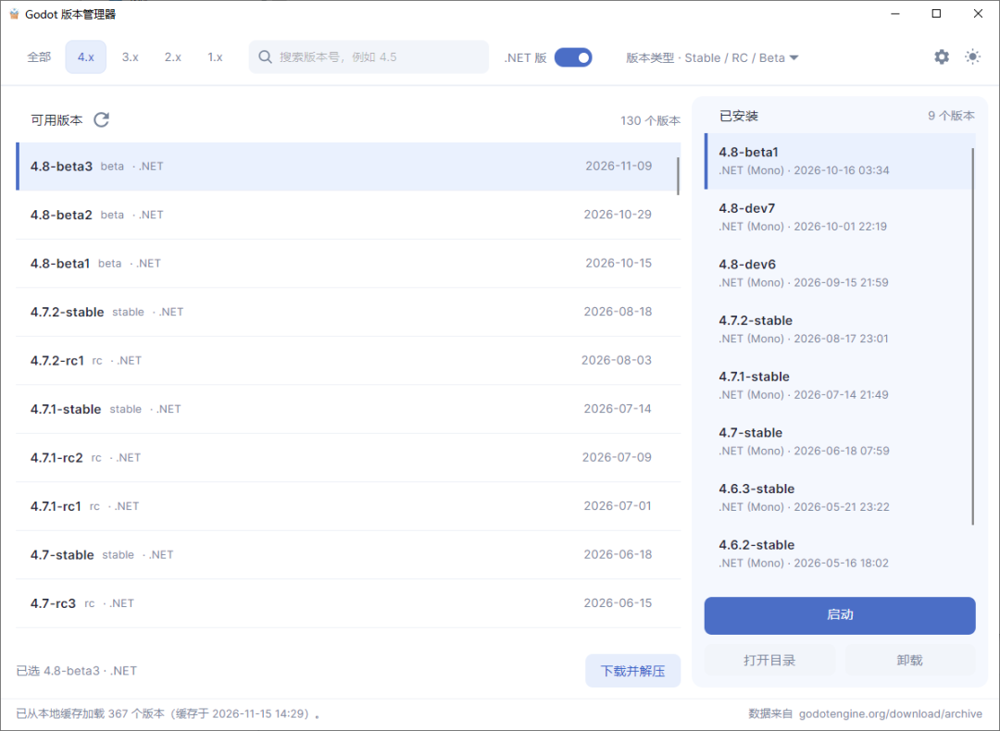

# Godot 版本管理器

使用 Avalonia UI 的 Godot Engine 版本管理小工具：从官方归档页解析版本列表，一键下载解压到指定目录，需要时直接启动对应版本。



## 功能

- 启动后自动解析 https://godotengine.org/download/archive/ 的全部发布版本，显示版本号、发布类型与日期；悬停版本行可直接打开该版本的发布公告（News）
- 版本列表联网成功后缓存到本地，默认 2 天有效；启动优先从缓存加载，点刷新图标重新拉取，30 秒内重复刷新从本地缓存解析
- 版本按版本号从大到小（语义化，如 4.10 > 4.9）排列，左侧竖向 tab 可按 4.x / 3.x / 2.x / 1.x 主版本筛选
- 发布类型按 Stable / RC / Beta / Dev / Alpha 五个复选框分别勾选，**默认勾前三个**；右侧显示筛选后的版本数，支持按版本号搜索、刷新
- **.NET 版默认勾选**（放在搜索框左侧），可切换为标准版；悬停版本行显示「新闻」「下载」按钮，下载 Windows 64 位官方包，显示进度并支持取消
- 勾选 .NET 版时在线版本列表会显示蓝色 `.NET` 标签；已安装列表同样用标签显示类型（`.NET` / 标准版），版本号、标签与安装时间单行展示
- 右上角设置图标打开配置窗口：界面语言（中文 / English，切换立即生效）、Godot 安装位置、安装包保留方式
- 版本来源网址、设置里的安装目录都是可点击链接：前者用浏览器打开，后者用文件浏览器打开（Windows 资源管理器 / macOS Finder / Linux 文件管理器），均跨平台
- 界面采用 Godot 蓝主配色：卡片与列表加框、阴影和层次，主操作按钮用强调色，跟随系统浅色 / 深色主题
- 安装包策略二选一：**保留 30 天，启动时自动清理过期文件**（默认）/ **安装完成后立即删除**
- 下载完成后自动解压到安装目录，并记录可执行文件位置
- 启动时自动扫描安装目录中已有的 Godot（含手动下载解压的版本），切换目录后立即显示
- 已安装版本列表支持「启动」「打开目录」「卸载」，双击条目也可直接启动
- 主界面与设置里的所有配置（语言、.NET 勾选、预发布类型、主版本 tab、安装目录、安装包策略）都会记住，下次打开保持一致
- 配置与安装记录保存在 `%LOCALAPPDATA%\GodotManager\state.json`

## 文档

开发文档在 [Docs/](Docs/README.md)：[架构](Docs/architecture.md) · [开发指南](Docs/development.md) · [构建与发布](Docs/build.md)。

## 关于

- 作者：v0tx
- 项目地址：https://github.com/wellingfine/godot-manager
- 技术栈：.NET 10 + Avalonia 12；软件内「设置 → 关于本软件」也可查看作者、版本与仓库地址

## 运行

需要 .NET 10 SDK：

```bash
dotnet run
```

或构建后运行 `bin/Debug/net10.0/GodotManager.exe`。

打包发行版：`Scripts\package.bat`（Windows）或 `bash Scripts/package.sh`（macOS / Linux），产物在 `dist/`；加 `--setup` 生成单文件自解压安装包，详见 [构建与发布](Docs/build.md#一键打包脚本)。

## 说明

- 下载直链使用官网提供的 `downloads.godotengine.org`，会重定向到官方对象存储，需要联网
- 默认安装目录为 `%LOCALAPPDATA%\GodotManager\versions`，每个版本解压到独立子目录，目录名沿用官方包名（如 `Godot_v4.4.1-stable_mono_win64`），包内自带的同名外层目录会被剥掉
- 扫描识别官方命名的 `Godot_v{版本}-{类型}[_mono]_win64.exe`（忽略 `_console.exe`），直接放在安装目录根下的 exe 也能识别
- 卸载会删除该版本的解压目录；若 exe 直接放在安装目录根下，则只删除该 exe，不会删掉整个安装目录
- 过期清理只处理 `downloads` 子目录内的 `.zip` / `.part`，安装目录里的其它文件（包括根目录下已有的 zip）不受影响
- 版本列表缓存位于 `%LOCALAPPDATA%\GodotManager\releases-cache.json`；可在 `state.json` 调整 `CacheExpirationDays`（默认 2 天）与 `RefreshCooldownSeconds`（默认 30 秒）
- `state.json` 中界面相关字段：`Language`（`zh` / `en`）、`UseMono`（默认 `true`）、`SelectedMajor`、`ShowStable` / `ShowRc` / `ShowBeta` / `ShowDev` / `ShowAlpha`（前三个默认 `true`）、`DeleteArchiveAfterInstall`（`false` = 保留 30 天，`true` = 下完即删）
- 语言切换与设置窗口里的改动即时生效并立即写入配置，无需重启
- 当前下载目标是 Windows 64 位编辑器（含/不含 .NET 支持）
